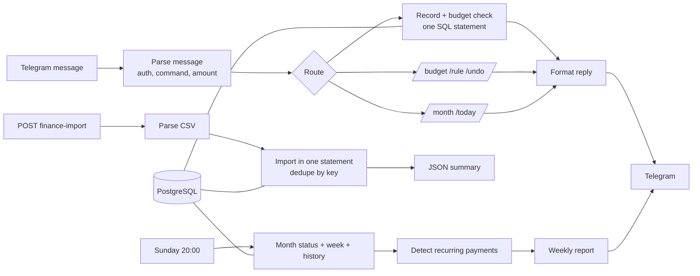

# Telegram Finance Tracker for n8n: Indonesian Amounts, Budgets, CSV Import and Recurring Payments

> Track spending by chatting. Send `25rb makan siang` and the bot records it, picks a category from your keyword rules, and warns you **once** at 80 % and **once** at 100 % of a monthly budget. Import a bank CSV safely (re-importing never duplicates), and get a weekly report with budget pace and automatically detected subscriptions.


## Table of contents

1. [What it does](#what-it-does)
2. [Architecture](#architecture)
3. [Using the bot](#using-the-bot)
4. [How it works](#how-it-works)
5. [Setup](#setup)
6. [CSV import](#csv-import)
7. [Configuration](#configuration)
8. [Database](#database)
9. [Security and privacy](#security-and-privacy)
10. [Testing](#testing)
11. [Troubleshooting](#troubleshooting)
12. [Limitations](#limitations)
13. [Roadmap](#roadmap)

## What it does

| Part | Behavior |
|---|---|
| **Natural input** | `25rb makan siang`, `grab 38.000 #transport`, `+5jt gaji`. Understands `25000`, `25.000`, `Rp25.000`, `25rb`, `25k`, `1,5jt`, `2 juta`. |
| **Auto-categories** | Keyword rules (seeded with about 40 Indonesian keywords such as grab, indomaret, pln, netflix). The longest matching keyword wins, `#tag` overrides, otherwise `other`. Teach new words with `/rule`. |
| **Budgets** | `/budget food 2jt` sets a monthly budget. Alerts at 80 % and 100 %, **each sent once per month and category**, even after undo or a restart. |
| **Summaries** | `/month` (spend vs budget with bars and month-end pace), `/today`, `/undo`. |
| **CSV import** | Bank statement CSV through an authenticated webhook. Comma, semicolon or tab, quoted fields, Indonesian number and date formats. Safe to import the same file again. |
| **Weekly report** | Sunday 20:00: last 7 days by category, biggest expenses, budgets with pace, and **recurring payments** (monthly or weekly, with the next date and a reminder when one is due within 7 days). |
| **Error alerts** | Any failed execution is sent to Telegram. |

All amounts are whole rupiah.

## Architecture



## Using the bot

| Message | Result |
|---|---|
| `25rb makan siang` | Expense Rp 25.000, category `food` (keyword "makan") |
| `makan siang 25rb` | Same: the amount can be first or last |
| `grab 38.000 #transport` | Category chosen explicitly |
| `+5jt gaji` or `/in 5jt gaji` | Income |
| `/month` | Month to date per category, budgets, net, projected month-end |
| `/today` | Today's entries |
| `/undo` | Removes **your** last entry if it is less than 30 minutes old |
| `/budget food 2jt` / `/budget food off` | Set or remove a monthly budget |
| `/rule grab transport` | "grab" in a note means `transport` from now on |
| `/help` | Short help |

Amount rules:

| You write | Meaning |
|---|---|
| `25000`, `25.000`, `25,000`, `Rp25.000`, `Rp 25.000` | 25 000 |
| `25rb`, `25k`, `25 ribu`, `25 rb` | 25 000 |
| `1,5jt`, `1.5jt`, `1,5 juta` | 1 500 000 |
| `2jt`, `2 juta` | 2 000 000 |
| `1.250.000`, `1,250,000`, `1.250.000,50` | 1 250 000 (decimals round to whole rupiah) |

With a suffix (`rb`, `jt`, ...), a single `.` or `,` is a decimal point, so `2.500rb` means 2 500, not 2 500 000. `5 kopi` is Rp 5 with the note "kopi" because `kopi` is not a suffix.

## How it works

### One statement per entry

Recording an expense is a single SQL statement: resolve the category, insert the row, read the month's spending *before* this entry, find which thresholds (80, 100) this entry crossed, insert those into `budget_alerts` with `ON CONFLICT DO NOTHING`, and return the result. The reply only mentions thresholds that were newly inserted, so an alert can never be sent twice, even when two messages arrive at once.

### CSV idempotency

Each imported row gets the key `md5(date | kind | amount | description) # n`, where `n` counts identical rows inside the file. Importing the same file again produces the same keys and adds nothing. Two real identical purchases on one day (two coffees) get `#1` and `#2` and are both kept. Telegram entries have no key, so manual entries are never blocked.

### Recurring payment detection

From the last 200 days of expenses:

1. Group by merchant: the first meaningful word of the note (digits, punctuation and words like "payment" or "transfer" are ignored).
2. Inside a merchant, cluster entries whose amounts are within 5 % of each other, so a monthly "grab unlimited" plan is found among random Grab rides.
3. A cluster needs at least 3 different days, a typical gap of 26-35 days (monthly) or 6-8 days (weekly), and at least 60 % of the gaps close to that (one stray charge is tolerated).
4. The next date is the same day next month (clamped to the month end) or last date plus 7 days. If it is already more than 10 days overdue, the payment is treated as cancelled and hidden.

## Setup

### Requirements

- n8n 1.x and PostgreSQL 13+
- A Telegram bot (BotFather) and your chat id

### Steps

1. Run [`sql/schema.sql`](sql/schema.sql). Optional: [`sql/example_setup.sql`](sql/example_setup.sql).
2. Import `workflows/telegram_finance_tracker.json`.
3. Create credentials: Postgres, Telegram, and Header Auth named `Finance import key` (for the CSV webhook).
4. In the **Parse Message** node, put your chat id(s) into `ALLOWED_CHAT_IDS`, for example `['123456789']`. Until you do, the bot answers nobody and shows the sender their chat id.
5. Replace `REPLACE_WITH_REPORT_CHAT_ID` (weekly report and error alert) and the `REPLACE_ID` credential slots.
6. Set the **Error Workflow** in Workflow Settings to this workflow.
7. Activate. Send `/help` to your bot.

The time zone for "today" and "this month" is in the `settings` table (`Asia/Jakarta` by default).

## CSV import

`POST /webhook/finance-import` with your Header Auth key and a JSON body:

```bash
curl -X POST https://n8n.example.com/webhook/finance-import \
  -H "Authorization: <your key>" -H "Content-Type: application/json" \
  -d "$(jq -Rs '{csv: .}' statement.csv)"
```

| Option | Default | Meaning |
|---|---|---|
| `columns` | auto | Map your headers: `{"date":"Tgl","description":"Ket","amount":"Nominal"}` (or `debit` and `credit`). |
| `date_order` | `dmy` | Use `mdy` for US-style dates. |
| `invert_sign` | `false` | Set `true` when charges are positive (credit card exports). |

Recognized without options: headers such as Date/Tanggal/Tgl, Description/Keterangan/Remarks, Amount/Jumlah/Nominal/Mutasi, Debit/Debet, Credit/Kredit. Negative amounts, `(25.000)` and `25.000 DB` are expenses; positive amounts and `CR` are income. Dates: `2026-10-05`, `05/10/2026`, `05-10-26`, `5 Okt 2026`.

The answer shows what happened:

```json
{ "status": "imported", "rows_in_file": 120, "parsed": 118, "skipped": 2, "inserted": 118, "duplicates": 0,
  "expense_total": 4210500, "income_total": 8000000, "errors": ["line 7: invalid date \"-\""] }
```

Limits: 1 MB and 5000 rows per request. Rows that cannot be read are skipped and the first five reasons are returned. Entries you typed in Telegram and the same purchase in a later CSV are **not** matched, so import statements for periods you did not track by hand, or delete the manual entries first.

## Configuration

| Setting | Where | Default |
|---|---|---|
| Allowed chats | `ALLOWED_CHAT_IDS` in *Parse Message* | none (fail closed) |
| Alert thresholds | `ARRAY[80, 100]` in *Record Transaction* (and the `level` CHECK in `budget_alerts`) | 80 and 100 |
| Weekly report time | *Weekly Schedule* | `0 20 * * 0` |
| Undo window | *Undo Last* query | 30 minutes |
| Time zone | `settings.timezone` | Asia/Jakarta |
| Keyword rules and budgets | tables or `/rule`, `/budget` | seeded rules, no budgets |

## Database

| Table | Purpose |
|---|---|
| `transactions` | Every expense and income, soft-deleted with `deleted`, CSV rows carry a unique `dedupe_key` |
| `budgets` | Monthly amount per category |
| `budget_alerts` | One row per month, category and threshold (makes alerts exactly-once) |
| `category_rules` | Keyword to category (plain lowercase text only; wildcard characters are blocked by a CHECK) |
| `settings` | Time zone |

```sql
-- Spending per category this month
SELECT category, SUM(amount) FROM transactions
WHERE kind = 'expense' AND NOT deleted AND tx_date >= date_trunc('month', now())::date
GROUP BY category ORDER BY 2 DESC;

-- Re-categorize old "other" entries after adding a rule
UPDATE transactions t SET category = r.category FROM category_rules r
WHERE t.category = 'other' AND lower(t.note) LIKE '%' || r.keyword || '%';
```

## Security and privacy

- **Fail-closed access.** Only chat ids in `ALLOWED_CHAT_IDS` can read or write anything. Everyone else gets a message with their own chat id and nothing else happens. Group chats have negative ids and must be listed explicitly. Everyone listed shares the same ledger.
- **CSV webhook** requires Header Auth. Keep the key server-side.
- **All SQL is parameterized.** Notes with quotes or SQL text are stored as data. Category names and rule keywords are restricted by CHECK constraints, so a rule can never act as a wildcard pattern.
- **Telegram output is HTML-escaped.**
- **Financial data.** The database holds your transactions. Restrict access, encrypt backups, and remove card or account numbers from CSV descriptions before importing.
- Message text from Telegram passes through Telegram's servers. Do not use this bot for anything you would not send over Telegram.

## Testing

- **Code nodes: 274 checks.** The amount parser (49 formats including thousands separators, decimals, suffixes and rejections), every command and its error paths, authorization (placeholder, unknown chat, group ids), reply formatting and escaping, the CSV parser (delimiters, quotes, BOM, CRLF, multi-line fields, 6 date formats, debit/credit, signs, inverted sign, column mapping, 12 rejection cases, 5000 rows) and recurring-payment detection (monthly, weekly, stray charges, stale payments, month-end and year boundaries, clusters by amount).
- **SQL and full lifecycle: 81 checks on a real PostgreSQL engine (PGlite).** Constraints, then real chat messages run through the shipped Code nodes and queries together: category resolution, budget alerts exactly once (including crossing both thresholds, undo, previous month), per-user undo with the 30-minute window, rules, summaries, CSV import (idempotent, overlapping files, repeated identical rows, quotes and SQL text, 5000 rows) and the weekly report built from real query output.

Not verified: a live n8n instance, the Telegram Trigger and Telegram delivery, and concurrent messages. The exactly-once alert guarantee relies on a primary key, but it was tested sequentially.

## Troubleshooting

| Problem | Fix |
|---|---|
| Bot replies "Not authorized" | Put the chat id shown in the message into `ALLOWED_CHAT_IDS` in *Parse Message*. |
| Bot does not react | Workflow inactive, or the Telegram credential/webhook is wrong. Telegram allows only one webhook per bot. |
| "I could not find an amount" | The message needs a number as its first or last word, for example `kopi 15rb`. |
| Wrong category | Use `#tag` once, or teach it: `/rule indomaret groceries`. |
| `5 kopi` recorded as Rp 5 | Intended: write `5rb kopi`. |
| CSV: "could not find the date, description and amount columns" | Use the `columns` option; the error lists the headers it saw. |
| CSV amounts look 1000x off | Check the number format of your bank. `1.000` is read as one thousand; use `columns` and, if needed, pre-convert the file. |
| No weekly report | Nothing happened in the last 7 days, this month or in the history. |

## Limitations

- Rupiah only, whole amounts. No multi-currency.
- One shared ledger for all allowed chats. No per-user budgets.
- One budget per category and month, the same amount every month.
- Detection of recurring payments needs 3 occurrences and uses the note text, so identical notes for different services (for example just "transfer") are not separated.
- No receipt photos and no direct bank connection.
- Undoing an entry does not take back budget alerts already sent.

## Roadmap

- Receipt photo to entry with a vision model
- Per-month budget overrides and rollover
- Savings goals and a net-worth view
- Matching CSV rows with manual entries
- Charts in the weekly report

## License

MIT. Add a `LICENSE` file to your repository.
